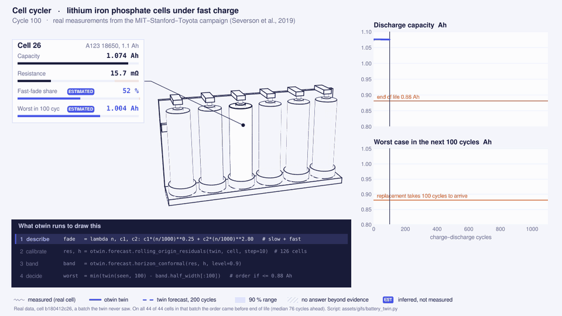
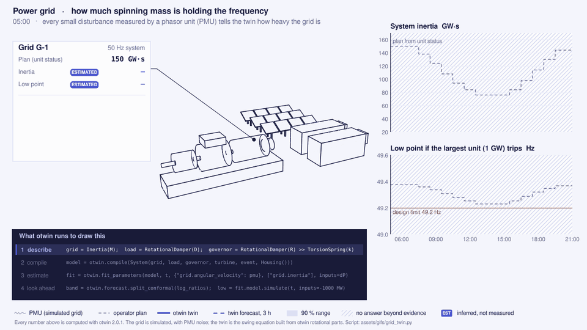
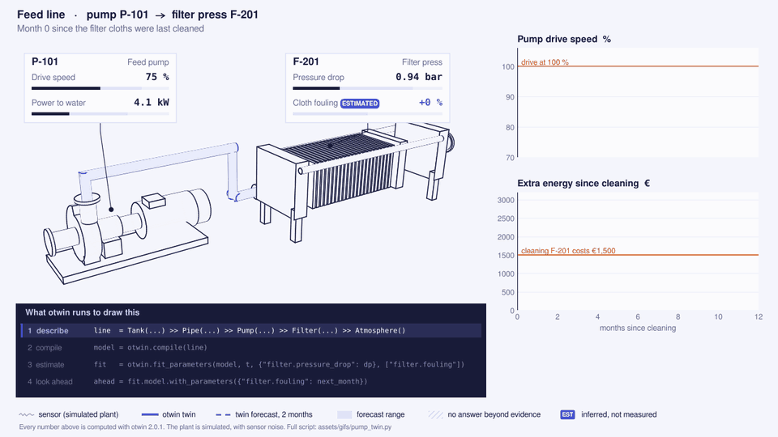
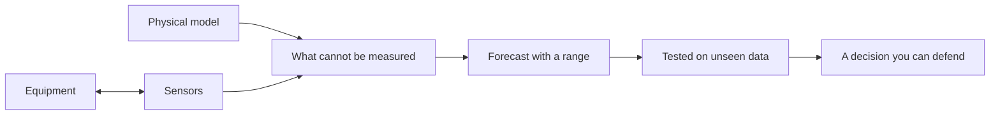

<div align="center">


# Otwin: open-source physics for Digital Twins

[](https://opensource.org/license/apache-2-0)
[](https://scorecard.dev/viewer/?uri=github.com/otwin-core/otwin)
[](https://api.reuse.software/info/github.com/otwin-core/otwin)
[](https://github.com/otwin-core/otwin/attestations)

<br>



<sub>Real data from 44 cells the twin had never seen (Severson et al., 2019). On every one of them the replacement order came before end of life, a median of 76 cycles ahead.</sub>

</div>

<br>

# A physics engine for real equipment

A model of a battery, a pump or a power grid is useful on paper. It becomes a **Digital Twin** when it stays connected to the real equipment, learns what cannot be measured from what can, and says what is likely to happen next, with a range and a clear limit on what it does not know.

Otwin is the open-source toolkit for that. You describe the equipment with physical parts (masses, springs, pipes, pumps, cells, inertias). Otwin turns them into a model that cannot create energy out of nothing, fits it to your sensors, and forecasts with a range that was tested on data the model never saw.

```bash
pip install otwin
```

# How Otwin works

<div align="center">



<sub>**Power grid.** Every small disturbance tells the twin how much spinning mass is holding the frequency. The operator's plan says the grid is safe at midday. The measured grid is lighter, so the twin asks for battery fast response two hours ahead. Simulated grid with PMU noise. [Script](assets/gifs/grid_twin.py)</sub>

<br>



<sub>**Pump and filter press.** Nobody can measure how fouled the filter cloths are. The twin estimates it from the pressure drop and says when cleaning costs less than the extra energy the pump is burning. Simulated plant with sensor noise. [Script](assets/gifs/pump_twin.py)</sub>

</div>

The code under each drawing is the code that produced its numbers.

<br>

# From a physical model to a Digital Twin



Every step is in the open, and every claim can be checked: another implementation of the same model must give the same answer, and the [specification](https://github.com/otwin-core/otwin-spec) has the tests to prove it.

<br>

# Repositories in this project

| Repository | What it is |
|---|---|
| [**`otwin`**](https://github.com/otwin-core/otwin) | The Python library: build, run, fit, forecast and check physical models, and connect them to field data |
| [**`otwin-spec`**](https://github.com/otwin-core/otwin-spec) | What an Otwin model means, written down, with a test suite any implementation must pass |
| [**`otwin-hybrid`**](https://github.com/otwin-core/otwin-hybrid) | A complete example: a battery degradation twin that mixes physics and machine learning |
| [**`otwin-systems`**](https://github.com/otwin-core/otwin-systems) | A growing catalogue of physical systems with known reference results |

<br>

# Where to start

| I want to... | Go to |
|---|---|
| See a complete twin | [`otwin-hybrid`](https://github.com/otwin-core/otwin-hybrid) |
| Build my own | [`otwin`](https://github.com/otwin-core/otwin) |
| Check an implementation | [`otwin-spec`](https://github.com/otwin-core/otwin-spec) |
| Contribute a system, a test or an example | [Contributing guide](https://github.com/otwin-core/otwin/blob/main/CONTRIBUTING.md) |

<br>

<div align="center">

> A twin should not only predict. It should show why its prediction can be trusted, and say so when the evidence is not there.

<sub> Copyright Otwin, 2026 · Apache 2.0 </sub>

</div>
